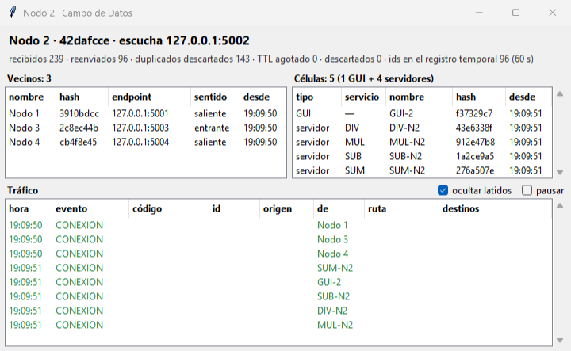
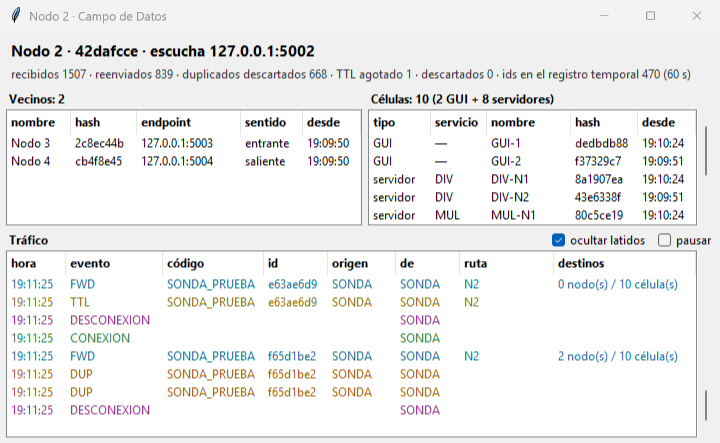
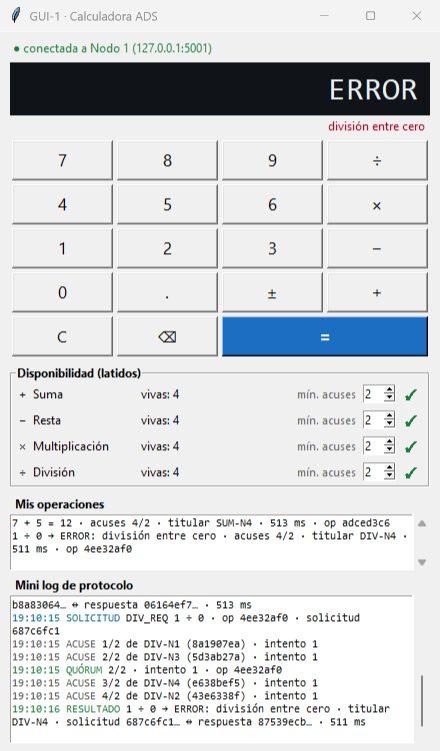
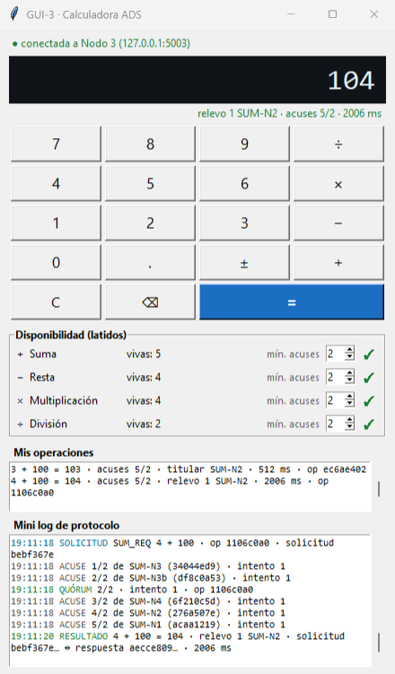
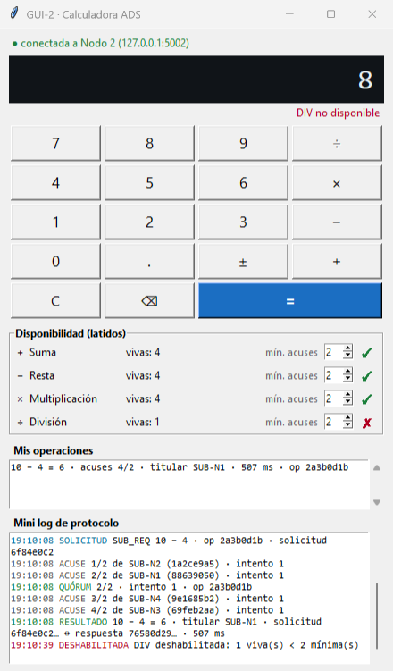
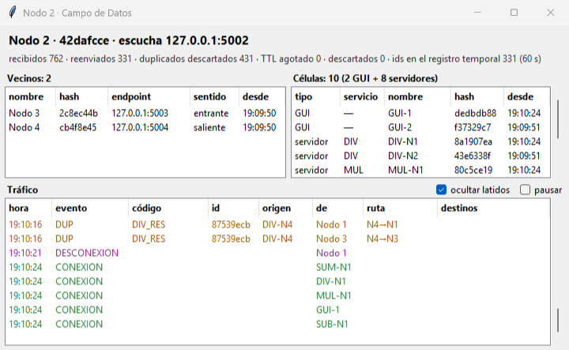
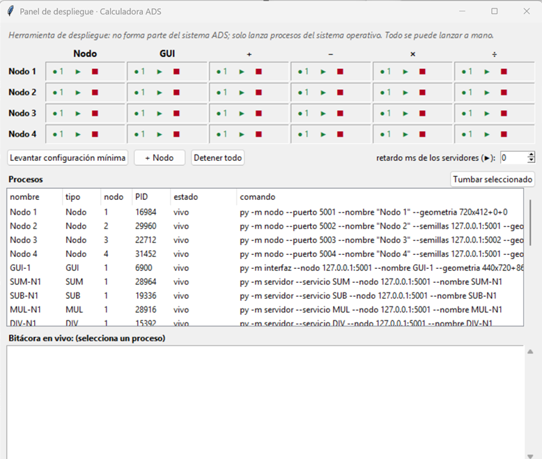
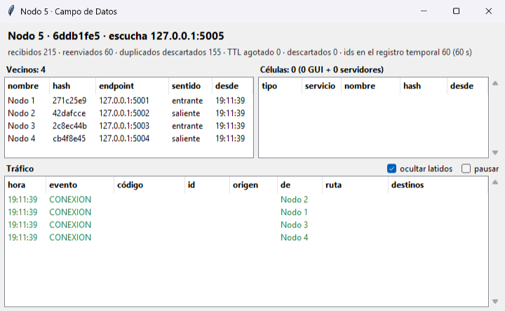

# Reporte Técnico — Calculadora ADS

**Materia:** Cómputo Distribuido

**Proyecto:** Segundo Parcial — Adecuación de la calculadora del primer parcial a una arquitectura ADS

**Fecha del enunciado:** 6 de octubre de 2026

| | |
|---|---|
| **Alumno** | `<NOMBRE COMPLETO>` |
| **Matrícula** | `<MATRÍCULA>` |
| **Grupo** | `<GRUPO>` |
| **Lenguaje** | Python 3.14, solo librería estándar |
| **Código fuente** | `<LIGA AL REPOSITORIO>` |
| **Video de demostración** | `<LIGA AL VIDEO>` |

---

## Contenido

| Parte | Secciones |
|---|---|
| **I. Introducción** | 1. Introducción, objetivo y alcance · 2. Matriz de trazabilidad con el enunciado |
| **II. Desarrollo** | 3. Arquitectura ADS · 4. Topología y descubrimiento · 5. Protocolos · 6. Códigos de Contenido y formato de los mensajes · 7. Broadcast · 8. Prevención de ciclos y duplicados · 9. Flujo de una operación · 10. Acuses y mínimo de acuses · 11. Respuesta única · 12. Disponibilidad por latidos · 13. Identificadores · 14. Failover · 15. Concurrencia · 16. Tolerancia a fallas · 17. Pruebas · 18. Panel de despliegue y sonda · 19. Decisiones de implementación y reutilización · 20. Diferencias respecto a lo visto en clase |
| **III. Conclusión** | 21. Conclusiones · 22. Limitaciones conocidas y trabajo futuro |
| **Anexos** | A. Glosario · B. Constantes del sistema · C. Documentación complementaria |
| **Referencias** | Fuentes consultadas (APA 7ª edición) |

---

# PARTE I — INTRODUCCIÓN

## 1. Introducción, objetivo y alcance

### 1.1 Contexto y planteamiento

La calculadora del primer parcial era un sistema cliente/servidor de tres capas: N
calculadoras, N servidores de cálculo y, en medio, **un middleware** por el que pasaba todo.
Funcionaba, pero tenía un punto único de falla declarado: si el middleware se caía, el sistema
entero se detenía.

El segundo parcial pide justo lo contrario. En una **arquitectura de sistemas autónomos
descentralizados (ADS)** no hay a quién preguntarle nada (Mori, 1993). Los datos circulan por un
**Campo de Datos** compartido, y cada pieza del sistema, llamada **célula**, toma de ahí lo que
le interesa según un **Código de Contenido**. Ninguna célula sabe quién más existe. Por eso
cualquiera se puede agregar o quitar sin avisarle a nadie.

El reto técnico de este proyecto no es la aritmética, sino lo que aparece cuando ya no hay
coordinador:

- cómo se encuentran los nodos entre sí sin una lista central;
- cómo se difunde un mensaje por una malla con ciclos sin que circule para siempre;
- cómo se logra que, de cuatro servidores que reciben la misma solicitud, **responda solo uno**
  sin que nadie lo designe;
- qué pasa cuando ese uno se muere a la mitad.

### 1.2 Objetivo general

Transformar la calculadora del primer parcial para operar bajo una arquitectura ADS: un Campo de
Datos de cuatro nodos en malla completa, células GUI y células servidor distribuidas, y
comunicación exclusivamente por broadcast con Códigos de Contenido para solicitudes y
respuestas. Ninguna función esencial puede depender de un componente único.

### 1.3 Objetivos específicos

1. Construir un **nodo** del Campo de Datos que forme la malla por sí solo, identifique qué
   entidad se le conecta y retransmita por broadcast sin interpretar el contenido.
2. Definir y documentar un **protocolo de conexión** y un **protocolo de comunicación** que no
   dependan del número de nodos ni de células.
3. Impedir que los mensajes circulen indefinidamente y que un mensaje repetido se retransmita.
4. Lograr que cada solicitud reciba **una sola respuesta**, aunque varias células servidor del
   mismo servicio la reciban, y sin introducir un coordinador.
5. Eliminar los puntos únicos de falla: que caiga un nodo, un servidor o el panel de
   demostración sin que se detenga el servicio.
6. Verificar todo con pruebas automatizadas y con una demostración en la que se pueda observar
   el recorrido de cada mensaje.

### 1.4 Alcance

Se construyeron tres programas, que son los que pide el enunciado (§5):

- **Nodo del Campo de Datos** (`nodo/`): forma la malla, acepta células y nodos y difunde.
- **Célula servidor** (`servidor/`): se configura con `--servicio SUM|SUB|MUL|DIV` y atiende
  ese único servicio.
- **Célula cliente GUI** (`interfaz/`): la calculadora con ventana de escritorio.

Se añadieron dos **herramientas de demostración que no forman parte del sistema**: un panel que
lanza y tumba procesos (`panel/`) y una sonda que inyecta mensajes de prueba (`sonda/`).

Todo está escrito en Python 3 con la **librería estándar**: sockets TCP, hilos, `hashlib` y
Tkinter (Python Software Foundation, 2025a, 2025b, 2025c, 2025d). No hay dependencias externas ni base de datos. El enunciado de este parcial no pide
persistencia, así que la del primer parcial no se trasladó. Se renuncia conscientemente a los
puntos extra de Java (§1 del enunciado).

Queda **fuera del alcance**, y se documenta en la sección 22: el algoritmo de foliado, las
células que levantan otras células, la detección de enlaces "medio abiertos" y la autenticación
de las entidades que se conectan.

### 1.5 Estructura del documento

La **Parte I** delimita el problema y amarra cada requisito del enunciado con el código, la
sección del reporte y el minuto del video. La **Parte II** es el desarrollo:

- arquitectura y topología (secciones 3 y 4);
- protocolos, códigos y formato de los mensajes (5 y 6);
- broadcast y prevención de ciclos (7 y 8);
- el flujo completo con bitácoras reales (9);
- la estrategia de respuesta única (10 a 12);
- identificadores, failover, concurrencia y tolerancia a fallas (13 a 16);
- pruebas, herramientas y decisiones (17 a 19);
- las diferencias respecto a lo visto en clase (20).

La **Parte III** concluye y enumera los límites conocidos.

Todas las bitácoras citadas son **reales**. Salen de una corrida del sistema completo con el
panel de despliegue el 11 de octubre de 2026, con el código final; las figuras son capturas de
esa misma corrida. Los hashes se muestran con sus primeros 8 caracteres.

---

## 2. Matriz de trazabilidad con el enunciado

Cada requisito, dónde está implementado (archivo → función), dónde se explica en este reporte y
en qué minuto del video se demuestra.

| § | Requisito | Implementación | Sección | Video |
|---|---|---|---|---|
| 1 | Cualquier lenguaje | Python 3.14, librería estándar | §1.4 | `<mm:ss>` |
| 3 | Originalidad | Código propio; reutilización del primer parcial declarada | §19.3 | — |
| 4 | Suma, resta, multiplicación y división vía Campo de Datos, broadcast y código | `servidor/calculo.py` → `calcular()`; `servidor/nucleo.py` → `Servidor._ejecutar()` | §9, §11 | `<mm:ss>` |
| 5 | Célula cliente (GUI): captura, genera la solicitud, recibe la respuesta | `interfaz/nucleo.py` → `Interfaz.solicitar()`, `procesar()`; `interfaz/gui.py` → `VentanaInterfaz` | §9, §10 | `<mm:ss>` |
| 5 | Célula servidor configurable por servicio | `servidor/__main__.py` (`--servicio`); `servidor/nucleo.py` → `Servidor` | §11 | `<mm:ss>` |
| 5 | Nodo: forma la malla, acepta conexiones, retransmite por broadcast | `nodo/nucleo.py` → `Nodo` | §4, §5, §7 | `<mm:ss>` |
| 6 | 4 nodos en malla completa | `Nodo._supervisar()`, `_marcar()`, `_difundir_pares()`, `_registrar_vecino()` | §4 | `<mm:ss>` |
| 6 | 5 células por nodo (20 en total) | `Nodo._registrar_entrante()` → tabla `celulas`; panel → "Levantar configuración mínima" | §4, §18 | `<mm:ss>` |
| 6 | Sin límite de nodos ni de células; sin cambiar el código | Gossip con una semilla cualquiera; panel → "+ Nodo"; `tests/test_malla.py` → `test_quinto_nodo_con_una_sola_semilla` | §4 | `<mm:ss>` |
| 7 | Toda solicitud y respuesta lleva Código de Contenido | `comun/codigos.py`; `celula/base.py` → `Celula.publicar()` | §6 | `<mm:ss>` |
| 7 | La respuesta es un mensaje nuevo con el id de la solicitud original y el resultado | `Servidor._ejecutar()` → cuerpo con `id_solicitud` y `resultado` | §6, §9 | `<mm:ss>` |
| 8 | Estructura mínima del mensaje | `comun/mensajes.py` → `nuevo()`, `validar_datos()` | §6 | — |
| 9 | Broadcast por el Campo de Datos | `Nodo._difundir()` | §7 | `<mm:ss>` |
| 9 | Evitar múltiples respuestas no deseadas (estrategia documentada) | `Servidor._rx_req()`, `_elegir()`, `_revisar_respaldo()`, `_ejecutar()`; `comun/huella.py` → `ranking()` | §10, §11 | `<mm:ss>` |
| 9 | Respuestas difundidas con su código de respuesta | `Servidor._ejecutar()` publica `X_RES` | §9 | `<mm:ss>` |
| 10.1 | Conectar los nodos en malla | `HOLA` / `BIENVENIDA` / `PARES`; regla de enlace duplicado en `_registrar_vecino()` | §4, §5.2 | `<mm:ss>` |
| 10.1 | Conectar GUIs y servidores a cada nodo | `celula/base.py` → `Celula._intentar()`; `Nodo._registrar_entrante()` | §5.2 | `<mm:ss>` |
| 10.1 | Identificar el tipo de entidad y controlar las conexiones activas | `HOLA.entidad`; tablas `vecinos` y `celulas`; `nodo/gui.py` → `VentanaNodo` | §5.2 | `<mm:ss>` |
| 10.1 | Independiente del número de instancias | Supervisor + gossip; ninguna lista fija | §4 | `<mm:ss>` |
| 10.2 | Broadcast entre nodos y células | `Nodo._difundir()` | §7 | `<mm:ss>` |
| 10.2 | Transporta los códigos de solicitud y de respuesta | Campo `codigo` del sobre | §6 | `<mm:ss>` |
| 10.2 | Impide la circulación indefinida | TTL + registro de vistos + ruta + horizonte dividido | §8 | `<mm:ss>` |
| 10.2 | Detecta mensajes ya recibidos | `comun/vistos.py` → `RegistroVistos.marcar_si_nuevo()` | §8 | `<mm:ss>` |
| 10.2 | Asocia la respuesta con su solicitud | `id_operacion` + `id_solicitud` en ACK y RES | §6, §9 | `<mm:ss>` |
| 11 | Id único por mensaje | `comun/huella.py` → `de_mensaje()` | §13 | — |
| 11 | Registro **temporal** de ids procesados | `RegistroVistos` (vigencia de 60 s) | §8 | `<mm:ss>` |
| 11 | No retransmitir un id repetido | `Nodo._difundir()` → `DUP`; `sonda --repetir` y `--id` | §8, §18 | `<mm:ss>` |
| 11 | La respuesta tiene id propio y conserva el de la solicitud | `mensajes.nuevo()` + `id_solicitud` | §6 | `<mm:ss>` |
| 11 | Estrategia contra respuestas duplicadas con varios servidores | Acuses → elección HRW → respaldos escalonados → doble revisión → ronda superada → deduplicación en la GUI | §10, §11 | `<mm:ss>` |
| 12 | Flujo general de 10 pasos | Reproducido con bitácoras reales | §9 | `<mm:ss>` |
| 13 | Esquema conceptual | Diagrama de la arquitectura | §3 | — |
| 14 | Nodos 1 a 4 ejecutándose en malla completa | Ventana del nodo: "Vecinos: 3"; matriz del panel | §4 | `<mm:ss>` |
| 14 | Una GUI y un servidor de cada operación por nodo | Ventana del nodo: "Células: 5 (1 GUI + 4 servidores)" | §4 | `<mm:ss>` |
| 14 | Solicitudes y respuestas con Código de Contenido | Mini log de la GUI; filas `FWD SUM_REQ` / `FWD SUM_RES` en los nodos | §9 | `<mm:ss>` |
| 14 | Asociación correcta solicitud ↔ respuesta | La GUI muestra `solicitud … ↔ respuesta …` | §9 | `<mm:ss>` |
| 14 | Prevención de ciclos y de mensajes duplicados | Filas y contador de `DUP`; sondas `--ttl 1`, `--repetir 3`, `--id` | §8, §18 | `<mm:ss>` |
| 14 | Ejecución correcta de las 4 operaciones | Una desde cada GUI, más la división entre cero | §9 | `<mm:ss>` |
| 15 | Sin nodo central ni punto único de falla | Gossip, inundación, elección sin coordinador, failover, latidos | §14, §16 | `<mm:ss>` |
| 15 | Formato de mensajes y códigos documentado | Este reporte; `comun/mensajes.py`, `comun/codigos.py` | §5, §6 | — |
| 15 | Recorrido de los mensajes observable | Campo `ruta`; bitácoras; ventanas de nodo y GUI | §7, §18 | `<mm:ss>` |

---

# PARTE II — DESARROLLO

## 3. Arquitectura ADS

### 3.1 Los conceptos de ADS

La arquitectura ADS (Autonomous Decentralized System) parte de dos ideas (Mori, 1993):

- **Autonomía controlable.** Cada subsistema puede operar, entrar y salir sin que los demás se
  enteren ni se reconfiguren.
- **Coordinabilidad autónoma.** Los subsistemas se coordinan sin un controlador central; cada uno
  decide por sí mismo con la información que circula.

El medio para lograrlo es el **Campo de Datos** (*Data Field*): todos los datos se publican en un
medio compartido, sin dirección de destino. Un mensaje no dice *a quién* va, sino *qué es*, y esa
es la función del **Código de Contenido**. Cada célula declara qué códigos le interesan y toma
del campo solo esos.

En este proyecto, la célula base implementa lo que en la Práctica 3 del curso se llamó **ACP**
(la parte común: conectarse, presentarse, filtrar por código). La lógica de cada servicio
corresponde a su **ASM**: calcular, en el servidor; capturar y mostrar, en la GUI.

### 3.2 El esquema del enunciado y la implementación

La Figura 1 del enunciado plantea cuatro nodos en malla completa, cada uno con las mismas cinco
células. La implementación es exactamente esa:

```
   GUI-1 SUM-N1 SUB-N1 MUL-N1 DIV-N1            GUI-2 SUM-N2 SUB-N2 MUL-N2 DIV-N2
          \    \    |    /    /                        \    \   |   /    /
           [ NODO 1 :5001 ] ═══════════════════════ [ NODO 2 :5002 ]
                 ║        ╲                       ╱        ║
                 ║          ╲                   ╱          ║     malla completa:
                 ║            ═══════╳═════════            ║     cada nodo ↔ los otros 3
                 ║          ╱                   ╲          ║     (6 enlaces TCP)
           [ NODO 3 :5003 ] ═══════════════════════ [ NODO 4 :5004 ]
          /    /    |    \    \                        /    /   |   \    \
   GUI-3 SUM-N3 SUB-N3 MUL-N3 DIV-N3            GUI-4 SUM-N4 SUB-N4 MUL-N4 DIV-N4

               4 GUI + 16 servidores = 20 células conectadas al Campo de Datos
```

| Componente | Paquete | Rol en ADS | Qué hace |
|---|---|---|---|
| Nodo | `nodo/` | Campo de Datos | Acepta conexiones, identifica qué entidad es cada una, forma la malla por gossip e inunda con supresión de duplicados y TTL. **No interpreta el contenido.** |
| Célula base | `celula/base.py` | ACP | Conectarse a un nodo, presentarse, failover, deduplicar y publicar. |
| Célula servidor | `servidor/` | ASM del servicio | **Un** servicio por instancia. Acusa, encola, participa en la elección, calcula, responde y emite latidos. |
| Célula GUI | `interfaz/` | ASM de la calculadora | Solicita, cuenta acuses, reintenta, muestra el resultado y habilita o deshabilita operadores según los latidos. |
| Panel | `panel/` | — (fuera del sistema) | Lanza y tumba procesos para la demostración. |
| Sonda | `sonda/` | — (fuera del sistema) | Inyecta mensajes de prueba con TTL o id elegidos. |

### 3.3 Nodos "bobos" a propósito

La decisión estructural más importante es que **el nodo nunca lee el `cuerpo` de un mensaje ni
conoce el catálogo de códigos**. Usa solo tres campos del sobre (`id`, `ttl` y `ruta`) y lee
`codigo` y `origen` únicamente para mostrarlos en su bitácora.

Consecuencias:

- Si mañana aparece un servicio nuevo (por ejemplo, potencia), **no se toca el nodo**. Basta con
  una célula que publique `POW_REQ` y otra que lo atienda.
- La decisión de qué hacer con un mensaje está donde debe estar en ADS: en las células.
- El nodo es pequeño y fácil de razonar: todo su trabajo con los datos es la función
  `Nodo._difundir()`, de unas 60 líneas.

### 3.4 Componentes y archivos

| Archivo | Responsabilidad | Clases / funciones principales |
|---|---|---|
| `comun/protocolo.py` | Framing NDJSON tolerante y enlace con cola de escritura | `serializar()`, `leer_mensajes()`, `Enlace` |
| `comun/mensajes.py` | Sobre de datos, mensajes de control, validación estructural | `nuevo()`, `validar_datos()`, `hola()`, `validar_hola()` |
| `comun/codigos.py` | Catálogo de Códigos de Contenido | `SERVICIOS`, `codigo()`, `separar()`, `CATALOGO` |
| `comun/huella.py` | Hashes SHA-256 y ranking de elección | `generar()`, `de_mensaje()`, `prioridad()`, `ranking()` |
| `comun/vistos.py` | Registro temporal de ids procesados | `RegistroVistos.marcar_si_nuevo()` |
| `comun/config.py` | Todas las constantes de tiempo, TTL y tamaños | — |
| `comun/bitacora.py` | Bitácora a consola y archivo, que nunca lanza | `Bitacora` |
| `comun/formato.py` | Números y operaciones legibles | `numero()`, `operacion()` |
| `nodo/nucleo.py` | El nodo, sin Tkinter | `Nodo` |
| `nodo/gui.py` | Ventana del nodo: vecinos, células, contadores y tráfico | `VentanaNodo` |
| `celula/base.py` | Lo común a toda célula | `Celula` |
| `servidor/calculo.py` | **La lógica de negocio**: las 4 operaciones | `calcular()` |
| `servidor/nucleo.py` | Rondas, acuse, cola, elección, relevo y latidos | `Servidor`, `Ronda`, `Programador` |
| `interfaz/nucleo.py` | Operaciones, quórum, reintentos y disponibilidad, sin Tkinter | `Interfaz`, `Operacion` |
| `interfaz/gui.py` | La calculadora | `VentanaInterfaz` |
| `panel/procesos.py`, `panel/gui.py` | Herramienta de despliegue | `Gestor`, `VentanaPanel` |
| `sonda/__main__.py` | Herramienta de inyección | `main()` |

**Regla que se respeta en todo el proyecto:** ningún `nucleo.py` importa Tkinter. Los núcleos
empujan eventos a una `queue.Queue` que la ventana vacía cada 100 ms desde su propio hilo. Así,
la interfaz nunca se toca desde un hilo de red (Tkinter no es seguro entre hilos; Python
Software Foundation, 2025c), y las pruebas levantan el sistema completo sin abrir una sola
ventana.

---

## 4. Topología y descubrimiento

### 4.1 Basta conocer a un nodo cualquiera

Ningún nodo tiene una lista de los demás. Cada uno arranca con cero o más **semillas** (endpoints
`host:puerto` de otros nodos) y, a partir de ahí, la malla se completa sola por **gossip**:

1. Al conectarse con un nodo, este le contesta `BIENVENIDA` con **todos los endpoints de nodos
   que conoce**.
2. Cada vez que el conjunto de nodos conocidos de un nodo **crece**, el nodo manda `PARES` con la
   lista a todos sus enlaces.
3. Un **supervisor** corre cada 2 s (`Nodo._supervisar()`). Por cada endpoint conocido que no sea
   propio y al que no esté conectado, lanza un marcador (`Nodo._marcar()`). Si falla, reintenta
   con backoff exponencial de 1 a 8 s.

El conjunto de conocidos solo crece y es finito, así que `PARES` deja de enviarse cuando todos
conocen a todos. El resultado es la **malla completa con cualquier número de nodos**: el
descubrimiento es epidémico, en el sentido de Demers et al. (1987).

En la demostración, el panel le da a cada nodo como semilla **un nodo vivo elegido al azar** (o
ninguno, si es el primero). Así se ve que ningún nodo es especial. Bitácora real del Nodo 2, cuya
semilla fue el Nodo 1:

```
19:09:50.022 [INICIO] Nodo 2 · 42dafcce · escucha 127.0.0.1:5002 · semillas: 127.0.0.1:5001
19:09:50.132 [CONEXION] vecino Nodo 1 (3910bdcc) en 127.0.0.1:5001 · saliente
19:09:50.133 [PARES] conozco 2 nodo(s) además de mí; aviso a 1 enlace(s)
19:09:50.140 [CONEXION] vecino Nodo 3 (2c8ec44b) desde 127.0.0.1:5003 · entrante
19:09:50.140 [PARES] conozco 3 nodo(s) además de mí; aviso a 2 enlace(s)
19:09:50.149 [CONEXION] vecino Nodo 4 (cb4f8e45) en 127.0.0.1:5004 · saliente
19:09:50.153 [RECHAZO] Nodo 4 ya tiene enlace conmigo (llegó otro entrante) → RECHAZO(duplicado)
```

En 130 ms el Nodo 2 aprendió por gossip que existían el 3 y el 4, se conectó con ellos y quedó
con sus tres vecinos. La última línea es la **regla de enlace duplicado** en acción (sección
4.2): el Nodo 2 y el Nodo 4 se marcaron al mismo tiempo, y uno de los dos enlaces se descartó.



### 4.2 La regla de enlace duplicado

Cuando dos nodos se descubren a la vez, cada uno marca al otro y quedan **dos** conexiones TCP
entre el mismo par. Hay que quedarse con una, y **ambos lados deben elegir la misma** sin
hablarlo. La regla (`Nodo._registrar_vecino()`) depende solo de datos que los dos conocen:

> Sea `preferido = min(mi_hash, hash_del_par)`, el nodo que "debe" iniciar el enlace. Si ya hay
> un enlace con ese par, se queda el **nuevo** solo si lo inició el preferido y el existente no;
> en cualquier otro caso se queda el **existente** y el nuevo recibe `RECHAZO(duplicado)`.

Como la función es la misma en los dos lados y solo depende de los hashes y de quién inició cada
enlace, ambos convergen al mismo. Durante las pruebas se descubrió que, 1 de cada ~25 veces, el
enlace sobrante se cerraba sin avisar y el par lo registraba como una caída falsa. Se corrigió
mandando siempre el `RECHAZO(duplicado)` antes de cerrar (sección 17.3).

### 4.3 Escalabilidad sin tocar el código

| Requisito del §6 / §10.1 | Cómo se cumple |
|---|---|
| El mismo programa de nodo para cualquier número de instancias | `py -m nodo --puerto P` con cualquier puerto; la malla se forma con una semilla cualquiera |
| Células en cualquier número | Cada célula genera su identidad y se presenta; el nodo no tiene cupos ni listas fijas |
| Sin valores fijos codificados | Ni el nodo ni las células tienen el número de nodos o de células en ninguna parte del código |

Se demostró en vivo levantando un **5º nodo** con "+ Nodo" en el panel. Con una sola semilla (el
Nodo 2), en menos de 100 ms quedó conectado con los otros cuatro (Figura 8). Los demás nodos lo
integraron sin reiniciar nada, y desde ese momento cada mensaje se ve en 5 nodos (1 `FWD` + 3
`DUP` en cada uno). También se probaron células extra del mismo servicio (`DIV-N2b`, `SUM-N3b`):
se integran igual.

---

## 5. Protocolos

### 5.1 Transporte: NDJSON sobre TCP

TCP no transporta mensajes, transporta un flujo de bytes (Eddy, 2022). Para delimitar mensajes
se usa **NDJSON**: un objeto JSON (Bray, 2017) por línea, terminado en `\n`. Es legible, y en la
demostración permite ver los mensajes como texto plano.

El framing viene del primer parcial (`comun/protocolo.py`), con tres cambios que la malla
necesita:

1. **Lector tolerante.** El lector anterior hacía `json.loads` *dentro* del generador: una sola
   línea inválida lanzaba una excepción, terminaba el generador y con él cerraba la conexión. En
   una malla, cualquiera puede mandar basura. Ahora cada línea se decodifica por separado; una
   inválida se reporta como `DROP` y la lectura sigue. Una línea de más de 64 KiB se descarta
   completa.
2. **Sin NaN ni Infinity.** Se serializa con `allow_nan=False` y se rechazan al leer, porque no
   son JSON estándar.
3. **`Enlace` con cola de escritura.** Cada enlace tiene un hilo lector y un **hilo escritor
   propio**. Quien difunde solo encola bytes, y un par lento o colgado nunca congela la
   inundación hacia los demás. Si la cola rebasa 5 000 mensajes, el enlace se da por muerto
   (`LENTO`).

### 5.2 Protocolo de conexión (§10.1)

Son mensajes de **control**: viajan por un solo enlace, **nunca se retransmiten** y llevan
`"ctrl"` en lugar de `"codigo"`, así que no se pueden confundir con datos.

| `ctrl` | Dirección | Campos | Propósito |
|---|---|---|---|
| `HOLA` | entidad → nodo | `entidad` (`NODO`, `INTERFAZ`, `SERVIDOR` o `SONDA`), `hash`, `nombre`, `servicio`, `escucha` (puerto; solo nodos), `version` | Presentación: **identifica el tipo de entidad** |
| `BIENVENIDA` | nodo → entidad | `hash`, `nombre`, `nodos` (endpoints conocidos) | Confirma el registro; da la lista para el gossip (nodos) y para el failover (células) |
| `PARES` | nodo → todos sus enlaces | `nodos` | Gossip: se manda cada vez que crece el conjunto de nodos conocidos |
| `RECHAZO` | nodo → entidad | `motivo` (`duplicado`, `autoconexion`, `version`, `invalido`), `hash` | Se manda y se cierra el enlace |

Ejemplos reales (de una célula servidor y de un nodo):

```json
{"ctrl":"HOLA","entidad":"SERVIDOR","hash":"276a507e…","nombre":"SUM-N2","servicio":"SUM",
 "escucha":null,"version":1}
{"ctrl":"HOLA","entidad":"NODO","hash":"42dafcce…","nombre":"Nodo 2","servicio":null,
 "escucha":5002,"version":1}
{"ctrl":"BIENVENIDA","hash":"3910bdcc…","nombre":"Nodo 1",
 "nodos":["127.0.0.1:5001","127.0.0.1:5002","127.0.0.1:5003","127.0.0.1:5004"]}
```

**Reglas del nodo:**

1. **Registro de entidades.** Una conexión entrante debe presentarse con un `HOLA` válido en 5 s
   o se cierra. Mientras no se presente, sus datos se descartan. Según el campo `entidad`, va a
   la tabla `vecinos` (nodos) o a la tabla `celulas` (GUI, servidor o sonda). Esas dos tablas
   son el **control de conexiones activas** que pide el §10.1, y se ven en vivo en la ventana del
   nodo (Figura 1).
2. **Célula que se reconecta** con el mismo hash antes de que se detecte la caída de su enlace
   viejo: gana el enlace nuevo y el viejo se cierra.
3. **Endpoint de un nodo.** Se forma con la IP real del socket y el puerto `escucha` del `HOLA`,
   no con lo que el nodo dice de sí mismo.
4. **Autoconexión.** Si un nodo se marca a sí mismo (porque recibió su propio endpoint por
   gossip), se manda `RECHAZO(autoconexion)` y ese endpoint queda marcado como propio.
5. **Puerto ocupado.** El nodo termina con un mensaje claro y código de salida 1.
6. **Bind a 127.0.0.1 por defecto**, para que el firewall de Windows no abra su diálogo en plena
   demostración. Con `--host 0.0.0.0` funciona en red local.

**Reglas de la célula** (`celula/base.py`): conecta a su `--nodo`, manda `HOLA` y espera
`BIENVENIDA` (3 s). **Hasta entonces no publica nada.** Guarda la lista de nodos que le dieron
como candidatos para el failover (sección 14) y la actualiza con cada `PARES`.

### 5.3 Protocolo de comunicación (§10.2)

Los mensajes de **datos** viajan **siempre por broadcast** dentro de un **sobre** común:

```json
{
  "id": "b8a83064…",            // identificador único del mensaje (SHA-256, 64 hex)
  "codigo": "SUM_REQ",          // Código de Contenido
  "origen": "dedbdb88…",        // hash de la célula que lo originó
  "tipo_origen": "INTERFAZ",
  "nombre_origen": "GUI-1",
  "ts": 1791767405.852,         // reloj del origen (solo informativo)
  "ttl": 8,                     // cuántos nodos más pueden procesarlo
  "ruta": [],                   // hashes de los nodos que ya lo procesaron, en orden
  "cuerpo": {"id_operacion": "adced3c6…", "intento": 1, "a": 7, "b": 5}
}
```

| Requisito del §10.2 | Mecanismo |
|---|---|
| Broadcast entre nodos y células | Inundación en `Nodo._difundir()` (sección 7) |
| Transportar los códigos de solicitud y respuesta | Campo `codigo` |
| Impedir la circulación indefinida | `ttl`, `ruta` y registro de vistos (sección 8) |
| Detectar mensajes ya recibidos | `id` + `RegistroVistos` en cada nodo y en cada célula |
| Asociar la respuesta con su solicitud | `cuerpo.id_operacion` y `cuerpo.id_solicitud` (sección 6) |

---

## 6. Códigos de Contenido y formato de los mensajes

### 6.1 Catálogo

Los códigos `REQ` y `RES` son los del enunciado (§7). Se agregan `ACK` por el modelo de acuses
visto en clase (sección 10) y `SRV_LAT` por los latidos de disponibilidad (sección 12).

| Servicio | Solicitud | Acuse | Respuesta | Símbolo |
|---|---|---|---|---|
| Suma | `SUM_REQ` | `SUM_ACK` | `SUM_RES` | + |
| Resta | `SUB_REQ` | `SUB_ACK` | `SUB_RES` | − |
| Multiplicación | `MUL_REQ` | `MUL_ACK` | `MUL_RES` | × |
| División | `DIV_REQ` | `DIV_ACK` | `DIV_RES` | ÷ |
| (todos) | — | — | — | `SRV_LAT`: latido de un servidor |
| (demostración) | — | — | — | `SONDA_PRUEBA`: solo lo inyecta la sonda; ninguna célula lo procesa |

### 6.2 Cuerpo de cada tipo de mensaje

| Código | Campos del `cuerpo` |
|---|---|
| `X_REQ` | `id_operacion`, `intento`, `a`, `b` |
| `X_ACK` | `id_operacion`, `id_solicitud` (id del REQ acusado), `intento`, `en_cola` |
| `X_RES` | `id_operacion`, `id_solicitud`, `intento`, `resultado` (o `null`), `error` (o `null`), `rol` (`"titular"` o `"relevo k"`), `ms` |
| `SRV_LAT` | `servicio`, `en_cola`, `atendidas`, `nodo` (hash), `nodo_nombre` |
| `SONDA_PRUEBA` | `nota` |

### 6.3 Tres identificadores, tres propósitos

Una respuesta se puede asociar con su solicitud por dos caminos, y cada uno cubre algo distinto:

| Identificador | Qué identifica | Por qué hace falta |
|---|---|---|
| `id` (sobre) | **Este mensaje** en particular | Detectar duplicados en la malla (§11). La respuesta lleva **su propio** `id`, distinto del de la solicitud |
| `id_solicitud` | El `X_REQ` exacto que se atendió | Es la "referencia al identificador de la solicitud original" que piden el §7 y el §11 |
| `id_operacion` | La operación del usuario, **estable entre reintentos** | Un reintento lleva `id` nuevo (si no, la malla lo descartaría como duplicado) pero la misma operación; así la GUI sabe que cualquier respuesta a cualquier intento es para ella |

La estructura cumple con la del §8 del enunciado:

| Campo sugerido (§8) | Dónde está |
|---|---|
| Identificador único del mensaje | `id` |
| Identificador de la solicitud original, en una respuesta | `cuerpo.id_solicitud` |
| Código de Contenido | `codigo` |
| Operandos, en una solicitud | `cuerpo.a`, `cuerpo.b` |
| Resultado, en una respuesta | `cuerpo.resultado` (o `cuerpo.error`) |
| Identificador de la célula que originó el mensaje | `origen` |
| Datos para el control del broadcast y de los ciclos | `ttl`, `ruta` |

### 6.4 Valores válidos

`a`, `b` y `resultado` siempre son números finitos. El servidor responde con `error` si un
operando no es número (o es `bool`, que en Python es un entero) o si el resultado no es finito
(por ejemplo, un *overflow*). La división entre cero se responde con
`error: "división entre cero"`. Es una **respuesta válida del sistema**, no una falla: se
difunde, se muestra en la GUI y cierra la operación.

---

## 7. Broadcast

### 7.1 El algoritmo de inundación

Cuando un nodo recibe un mensaje de datos por un enlace `L` (`Nodo._difundir()`):

```
validar la estructura del sobre                 → si falla: DROP (el enlace sigue vivo)
si el id ya está en el registro de vistos       → DUP: no se procesa ni se retransmite
ttl = min(ttl, 16)
si ttl <= 0                                      → TTL: no se procesa
ttl -= 1 ;  ruta.append(mi_hash)
serializar UNA vez
entregar a TODAS mis células, excepto L
si ttl > 0: entregar a cada vecino NODO, excepto L y los que ya están en la ruta
bitácora FWD: código, id, origen, de, ruta, destinos
```

La inundación es **genérica** (Tanenbaum & Van Steen, 2023): no usa tablas de ruteo ni conoce la
topología, y funcionaría igual en una malla incompleta. En la malla completa de 4 nodos, cada mensaje se procesa **una vez en
cada nodo** y cada nodo distinto del de entrada recibe además **dos copias duplicadas**, que
descarta. Esa es la evidencia en vivo de la prevención de duplicados.

### 7.2 Un mensaje real, nodo por nodo

La solicitud `7 + 5` de la GUI-1 (`SUM_REQ #b8a83064`), vista en las bitácoras de los cuatro
nodos:

```
Nodo 1  05.852 [FWD] SUM_REQ #b8a83064 origen=GUI-1 de=GUI-1  ruta=N1     ttl=7 → 3 nodo(s) / 4 célula(s)
Nodo 2  05.853 [FWD] SUM_REQ #b8a83064 origen=GUI-1 de=Nodo 1 ruta=N1→N2 ttl=6 → 2 nodo(s) / 5 célula(s)
Nodo 2  05.853 [DUP] SUM_REQ #b8a83064 de Nodo 3: ya procesado; no se retransmite
Nodo 2  05.854 [DUP] SUM_REQ #b8a83064 de Nodo 4: ya procesado; no se retransmite
Nodo 3  05.853 [FWD] SUM_REQ #b8a83064 origen=GUI-1 de=Nodo 1 ruta=N1→N3 ttl=6 → 2 nodo(s) / 5 célula(s)
Nodo 3  05.854 [DUP] SUM_REQ #b8a83064 de Nodo 4: ya procesado; no se retransmite
Nodo 3  05.854 [DUP] SUM_REQ #b8a83064 de Nodo 2: ya procesado; no se retransmite
Nodo 4  05.853 [FWD] SUM_REQ #b8a83064 origen=GUI-1 de=Nodo 1 ruta=N1→N4 ttl=6 → 2 nodo(s) / 5 célula(s)
Nodo 4  05.853 [DUP] SUM_REQ #b8a83064 de Nodo 3: ya procesado; no se retransmite
Nodo 4  05.855 [DUP] SUM_REQ #b8a83064 de Nodo 2: ya procesado; no se retransmite
```

Se observa:

- El **Nodo 1** (el de entrada) lo entrega a sus otras 4 células (no se lo devuelve a la GUI-1,
  que lo envió) y a los 3 nodos. No registra ningún `DUP`: la `ruta` ya lo incluye, y los demás
  no se lo regresan.
- Los **Nodos 2, 3 y 4** lo entregan a sus 5 células y lo reenvían a los 2 nodos que no están en
  la ruta. Las copias que se cruzan entre ellos son `DUP`.
- El campo `ruta` muestra el **recorrido observable** que pide el §15 (`N1→N2`).
- En total, el mensaje llegó **exactamente una vez** a cada una de las otras 19 células.

### 7.3 Las células filtran por código

Toda célula recibe **todo** lo que su nodo inunda, y decide por Código de Contenido:

| Célula | Procesa | Ignora |
|---|---|---|
| Servidor X | `X_REQ`; `X_ACK` (para saber quiénes acusaron); `X_RES` (para saber que ya se respondió) | Todo lo demás. Los `SRV_LAT` se ignoran sin registrarlos (son ruido) |
| GUI | `*_ACK` y `*_RES` **solo si el `id_operacion` es suyo**; `SRV_LAT` | `*_REQ` siempre (así **no ve las solicitudes de las otras GUIs**) y los ACK/RES de operaciones ajenas |

Las células ignoradas dejan constancia en su bitácora técnica (no en la vista del usuario). Por
ejemplo, la GUI-2 ante la operación de la GUI-1, y una célula de otro servicio:

```
GUI-2   19:10:05.853 [IGNORA] SUM_REQ de GUI-1 (b8a83064): no es para una GUI
GUI-2   19:10:06.365 [IGNORA] SUM_RES de SUM-N4 (06164ef7): operación ajena
DIV-N3  19:10:05.854 [IGNORA] SUM_REQ de GUI-1 (b8a83064): no es de DIV
```

---

## 8. Prevención de ciclos y duplicados

Una malla completa está llena de ciclos (N1→N2→N3→N1…). Sin defensas, un solo mensaje se
multiplicaría para siempre. Se usan **cuatro defensas**; cada una cubre un hueco de las otras.

### 8.1 Defensa 1: id único + registro temporal

Cada mensaje tiene un id SHA-256 irrepetible (sección 13). Cada nodo guarda en un
`RegistroVistos` los ids que ya procesó (`comun/vistos.py`):

- Es un `OrderedDict` de `id → instante de expiración`, en orden de llegada.
- **Vigencia: 60 s.** Como todos los ids tienen la misma vigencia, el orden de llegada es también
  el de expiración, así que purgar es solo sacar del frente mientras el primero esté vencido.
- Tope de 100 000 ids, por si llegara una avalancha.
- **`marcar_si_nuevo(id)` es atómico** (va bajo un `Lock`). Si dos copias del mismo mensaje
  llegan al mismo tiempo por dos enlaces (dos hilos lectores distintos), solo una recibe `True`,
  y solo esa se reenvía.

Es un registro **temporal**, tal como pide el §11: recordar todos los ids para siempre agotaría
la memoria. El tamaño del registro se ve en vivo en la ventana del nodo ("ids en el registro
temporal").

### 8.2 Defensa 2: TTL

El `ttl` cuenta cuántos nodos más pueden procesar el mensaje. Las células publican con 8; cada
nodo lo decrementa y, al llegar a 0, entrega a sus células pero no reenvía a otros nodos. Un TTL
mayor que 16 que llegue de la red se recorta.

El TTL cubre el **límite honesto del registro temporal**: si un duplicado llegara después de los
60 s de vigencia, el registro ya lo habría olvidado y volvería a circular, pero el TTL lo frena
de todos modos. En la malla completa el diámetro es 1, así que un TTL de 8 sobra; con
topologías más grandes el TTL debe ser al menos el diámetro.

### 8.3 Defensa 3: horizonte dividido + ruta

Un nodo **nunca** devuelve un mensaje por el enlace por el que llegó, ni lo manda a un nodo que
ya aparece en `ruta`. Esto no es necesario para la corrección (el registro de vistos ya lo
cubriría), pero evita tráfico inútil. Por eso el nodo de entrada no registra `DUP`.

### 8.4 Defensa 4: deduplicación en la célula

Cada célula tiene **su propio** `RegistroVistos`. Cubre un caso que el nodo no puede ver: una
célula que hizo failover a otro nodo podría recibir por el nodo nuevo copias de mensajes que ya
le había entregado el viejo. Además, una célula descarta los ecos de lo que ella misma publicó.

### 8.5 Evidencia con la sonda

La sonda (sección 18) inyecta mensajes `SONDA_PRUEBA`, que ninguna célula procesa, para
ejercitar cada defensa por separado. Corrida real en el Nodo 2 (con el Nodo 1 ya caído, malla de
3 nodos):

```
# py -m sonda --nodo 127.0.0.1:5002 --ttl 1      → solo lo procesa el Nodo 2
Nodo 2  [FWD] SONDA_PRUEBA #e63ae6d9 origen=SONDA de=SONDA ruta=N2 ttl=0 → 0 nodo(s) / 10 célula(s)
Nodo 2  [TTL] SONDA_PRUEBA #e63ae6d9: ttl agotado aquí; se entregó a mis células pero no se reenvía a nodos

# py -m sonda --nodo 127.0.0.1:5002 --repetir 3  → la MISMA copia tres veces
Nodo 2  [FWD] SONDA_PRUEBA #f65d1be2 origen=SONDA de=SONDA ruta=N2 ttl=7 → 2 nodo(s) / 10 célula(s)
Nodo 2  [DUP] SONDA_PRUEBA #f65d1be2 de SONDA: ya procesado; no se retransmite
Nodo 2  [DUP] SONDA_PRUEBA #f65d1be2 de SONDA: ya procesado; no se retransmite

# py -m sonda --nodo 127.0.0.1:5003 --id b7ecd396…  → reinyecta en el Nodo 3 un id que ya circuló
Nodo 3  [DUP] SONDA_PRUEBA #b7ecd396 de SONDA: ya procesado; no se retransmite
```

- `--ttl 1`: el mensaje no salió del Nodo 2.
- `--repetir 3`: las dos copias repetidas murieron **en el Nodo 2**, sin llegar a los demás. Esa es
  justamente la evidencia de que un nodo no retransmite un id repetido. Los Nodos 3 y 4
  registraron 1 `FWD` y 1 `DUP` cada uno, igual que con cualquier otro mensaje.
- `--id`: el Nodo 3 reconoce el id que había procesado antes y lo descarta. Muestra que la
  detección funciona **en cualquier nodo** mientras el id siga vigente.



---

## 9. Flujo de una operación (los 10 pasos del §12)

Recorrido real de **`7 + 5` desde la GUI-1**, con los 4 nodos y las 20 células vivos. Todas las
horas son de las 19:10.

**Paso 1 — El usuario captura la operación en una GUI.** Teclea `7`, `+`, `5` y `=` en la GUI-1.
Antes de aceptar el `=`, la GUI comprueba que esté conectada y que el servicio `SUM` esté
habilitado en ese momento (sección 12).

**Paso 2 — La GUI genera la solicitud con identificador único y Código de Contenido.**
`Interfaz.solicitar()` crea el `id_operacion` y **registra la operación antes de publicarla**: un
acuse muy rápido podría llegar antes de que exista. Luego publica el `SUM_REQ`, cuyo sobre recibe
un `id` propio:

```
GUI-1   05.852 [SOLICITUD] SUM_REQ 7 + 5 · op adced3c6 · solicitud b8a83064
```

**Paso 3 — La GUI la envía a su nodo.** Por su único enlace, al Nodo 1.

**Paso 4 — El nodo la difunde a los demás nodos y a sus células.**

```
Nodo 1  05.852 [FWD] SUM_REQ #b8a83064 origen=GUI-1 de=GUI-1 ruta=N1 ttl=7 → 3 nodo(s) / 4 célula(s)
```

**Paso 5 — Los nodos descartan las copias ya procesadas.** Cada uno de los Nodos 2, 3 y 4 hace 1
`FWD` y 2 `DUP` (sección 7.2).

**Paso 6 — Las células servidor revisan el código.** Las 16 células servidor y las otras 3 GUIs
reciben el mensaje. Solo las 4 `SUM` lo procesan; las demás registran `IGNORA` (sección 7.3).

**Paso 7 — La célula servidor que debe atenderla ejecuta la operación.** Las 4 `SUM` **acusan de
inmediato** (`SUM_ACK`) y encolan. A los 0.5 s, las cuatro calculan el mismo ranking por hash
entre las que acusaron y llegan a la misma conclusión sin hablarse: la titular es `SUM-N4`
(sección 11). Bitácoras reales de la titular y de un respaldo:

```
SUM-N4  05.853 [RX] SUM_REQ op adced3c6 · intento 1 de GUI-1: 7 + 5 (solicitud b8a83064)
SUM-N4  05.854 [ACUSE] SUM_ACK op adced3c6 · intento 1 → GUI-1 (acuse 8a47f4b9)
SUM-N4  05.854 [COLA] op adced3c6 · intento 1 encolada (0 antes en espera)
SUM-N4  05.856 [RX] SUM_ACK op adced3c6 · intento 1 de SUM-N1 → 2 acusador(es)
SUM-N4  05.856 [RX] SUM_ACK op adced3c6 · intento 1 de SUM-N2 → 3 acusador(es)
SUM-N4  05.856 [RX] SUM_ACK op adced3c6 · intento 1 de SUM-N3 → 4 acusador(es)
SUM-N4  06.363 [TITULAR] op adced3c6 · intento 1 · rank 0 de 4 [SUM-N4, SUM-N3, SUM-N1, SUM-N2]

SUM-N3  06.364 [RESPALDO] op adced3c6 · intento 1 · rank 1 de 4 [SUM-N4, SUM-N3, SUM-N1, SUM-N2];
               titular SUM-N4; relevo si nadie responde en 1.5 s
```

**Paso 8 — El servidor genera la respuesta** con un `id` de mensaje nuevo (`06164ef7`), el
identificador de la solicitud original (`b8a83064`), el resultado y el código `SUM_RES`:

```
SUM-N4  06.364 [RES] SUM_RES op adced3c6 · intento 1 · 7 + 5 = 12 · titular · solicitud b8a83064 ↔ respuesta 06164ef7 · 510 ms
```

**Paso 9 — La respuesta se distribuye por broadcast.** Igual que la solicitud, con la ruta
inversa:

```
Nodo 4  06.364 [FWD] SUM_RES #06164ef7 origen=SUM-N4 de=SUM-N4 ruta=N4 ttl=7 → 3 nodo(s) / 4 célula(s)
Nodo 1  06.364 [FWD] SUM_RES #06164ef7 origen=SUM-N4 de=Nodo 4 ruta=N4→N1 ttl=6 → 2 nodo(s) / 5 célula(s)
```

Los otros tres servidores `SUM` también reciben la respuesta, y con eso liberan su papel de
respaldo:

```
SUM-N3  06.365 [RX] SUM_RES op adced3c6 · intento 1 de SUM-N4 (titular); 1 ronda(s) mía(s) quedan resueltas
SUM-N3  07.855 [LIBERADO] op adced3c6 · intento 1 ya está resuelta; respaldo 1 liberado
```

**Paso 10 — Las GUIs reciben la respuesta y la GUI correspondiente la muestra.** Las cuatro GUIs
reciben el `SUM_RES`; solo la GUI-1 reconoce el `id_operacion` como suyo. Su mini log de
protocolo:

```
GUI-1   05.852 [SOLICITUD] SUM_REQ 7 + 5 · op adced3c6 · solicitud b8a83064
GUI-1   05.854 [ACUSE] 1/2 de SUM-N1 (acaa1219) · intento 1
GUI-1   05.855 [ACUSE] 2/2 de SUM-N2 (276a507e) · intento 1
GUI-1   05.855 [QUÓRUM] 2/2 · intento 1 · op adced3c6
GUI-1   05.856 [ACUSE] 3/2 de SUM-N3 (34044ed9) · intento 1
GUI-1   05.856 [ACUSE] 4/2 de SUM-N4 (6f210c5d) · intento 1
GUI-1   06.365 [RESULTADO] 7 + 5 = 12 · titular SUM-N4 · solicitud b8a83064… ↔ respuesta 06164ef7… · 513 ms
```

La línea `RESULTADO` muestra la **asociación solicitud ↔ respuesta** que pide el §14: el `id` de
la solicitud y el de la respuesta, que son distintos, y quién respondió.

**Resultado de la verificación completa.** En la misma corrida se hicieron `7 + 5`, `10 − 4`,
`6 × 7`, `7 ÷ 2` y `1 ÷ 0`, una desde cada GUI. En las cinco, las bitácoras muestran el mismo
patrón: **4 `ACUSE`, 1 `TITULAR`, 3 `LIBERADO` y exactamente 1 `RES`**. Las otras tres GUIs
registraron `IGNORA`, y cada nodo distinto del de entrada vio 1 `FWD` y 2 `DUP` por mensaje. La
división entre cero llegó como respuesta válida con su error
(`1 ÷ 0 → ERROR: división entre cero`).



**Sobre la latencia.** Una operación tarda ~510 ms, y casi todo es espera deliberada: los 0.5 s
de la ventana de elección (sección 11). El viaje por la malla y el cálculo suman unos
milisegundos. Es el costo de que la respuesta sea única sin un coordinador, y es configurable
(`VENTANA_ELECCION` en `comun/config.py`).

---

## 10. Acuses y mínimo de acuses

### 10.1 El servidor acusa al recibir, no al terminar

Cuando una célula servidor recibe un `X_REQ` de su servicio, **publica el `X_ACK` de inmediato**,
en el mismo hilo que leyó el mensaje y **antes** de encolar. El acuse prueba **recepción**, no
cálculo. El retardo artificial (`--retardo-ms`, que se usa para simular una célula lenta) solo
afecta al cálculo y nunca atrasa el acuse.

Los acuses viajan por broadcast como cualquier mensaje, así que cumplen dos funciones:

1. La **GUI** los cuenta para saber cuántas células tienen su operación.
2. Las **otras células servidor** del mismo servicio los usan para saber quiénes van a participar
   en la elección (sección 11).

### 10.2 Quórum por intento

Cada operación tiene un **mínimo de acuses** configurable: 2 por defecto, `--acuses-min` al
arrancar la GUI, y ajustable en vivo con un control por operación en la ventana. La GUI:

- cuenta los acusadores **por intento**, en un conjunto separado para cada uno. No se acumulan
  entre intentos: una célula que acusó el intento 1 y luego murió ya no tiene la operación, y
  contarla daría un quórum falso;
- **acepta la respuesta solo con quórum.** Si la respuesta llega antes que el quórum (lo cual es
  posible, porque los mensajes viajan por caminos distintos), se **retiene** y se acepta en
  cuanto se completa el quórum.

**Por qué el mínimo importa:** garantiza que al menos K células tienen la operación en su cola,
y esas son justamente las que pueden relevar a la titular si falla. Con un mínimo de 2, siempre
hay al menos un respaldo.

### 10.3 Plazos y reintentos

Un reloj de 100 ms revisa la operación en vuelo:

| Situación | Plazo | Acción al vencer |
|---|---|---|
| Sin quórum | 1.5 s desde el envío del intento actual | Reintento |
| Con quórum pero sin respuesta | `t_quorum + 0.5 + 1.5 · n_acusadores + 2` s (dinámico: da tiempo a que actúen todos los respaldos) | Reintento |
| Se agotan los 3 intentos | — | `FALLIDA`, con el motivo |

Un **reintento** reusa el mismo `id_operacion` con `intento + 1` y lleva un `id` de mensaje
**nuevo**. Si llevara el mismo `id`, la malla lo descartaría como duplicado.

### 10.4 Respuestas de más

- Una respuesta para una operación ya `RESUELTA` se registra como `DUPLICADA descartada`. Es la
  última línea de defensa; en condiciones normales no ocurre, y en la corrida final no ocurrió
  ninguna vez.
- Una respuesta para una operación `FALLIDA` se registra como `TARDÍA descartada`.

---

## 11. Respuesta única

El §9 del enunciado reconoce el problema: hay una célula servidor de cada operación en cada nodo,
así que **varias reciben cada solicitud**, y el diseño debe definir cómo se evita que respondan
todas. La estrategia elegida es una **elección determinista sin coordinador**.

### 11.1 Elección por hash entre las que acusaron (HRW)

Cada célula servidor:

1. Recibe el `X_REQ`, acusa y encola (sección 10).
2. Escucha los `X_ACK` de las demás y arma el conjunto de **acusadores** de esa ronda
   (`id_operacion`, `intento`).
3. Espera la **ventana de elección** (0.5 s desde que recibió el REQ) para que lleguen los
   acuses.
4. Ordena a los acusadores por

   ```
   prioridad(célula) = SHA-256( hash_célula | id_operacion | intento )
   ```

   y ve su posición `r` en ese orden.

Es *rendezvous hashing* o HRW (Thaler & Ravishankar, 1998). Cada célula calcula **el mismo
orden** sobre **el mismo conjunto**, así que todas llegan a la misma conclusión **sin
intercambiar un solo mensaje extra y sin que nadie la designe**:

| Posición | Rol | Qué hace |
|---|---|---|
| `r = 0` | **TITULAR** | Calcula y responde con `rol = "titular"` |
| `r ≥ 1` | **RESPALDO r** | Agenda una revisión a los `r · 1.5 s`. Si para entonces nadie respondió, toma el **RELEVO** y responde con `rol = "relevo r"`; si ya hubo respuesta, queda **LIBERADO** |

Propiedades:

- **Sin punto único de falla.** Si la titular muere después de acusar, el respaldo 1 responde a
  los ~2 s; si también muere, el respaldo 2, y así sucesivamente.
- **Balanceo.** El hash reparte las titularidades de manera uniforme. En la prueba
  `test_huella`, sobre 4 000 operaciones, cada una de 4 células fue titular 1 000 ± 150 veces.
  En la corrida en vivo, las titulares de las primeras cinco operaciones fueron `SUM-N4`,
  `SUB-N1`, `MUL-N2`, `DIV-N2` y `DIV-N4`.
- **Un reintento es una ronda nueva.** El `intento` entra al hash, así que un reintento puede
  tocarle a otra titular, por ejemplo si la anterior está colgada.

### 11.2 Diagrama de tiempo: caso normal

Operación `7 + 5` (op `adced3c6`), tiempos reales relativos al REQ:

```
t (s)     0.0    0.5                  2.0                  3.5                  5.0
          │      │                    │                    │                    │
GUI-1     REQ────RES ►✓ 12 (513 ms)

SUM-N4    RX·ACK─TITULAR·RES (510 ms)
SUM-N3    RX·ACK─RESPALDO 1·ve RES────LIBERADO
SUM-N1    RX·ACK─RESPALDO 2·ve RES─────────────────────────LIBERADO
SUM-N2    RX·ACK─RESPALDO 3·ve RES──────────────────────────────────────────────LIBERADO
                 └ ventana de elección (0.5 s): todas eligen a SUM-N4
```

### 11.3 Diagrama de tiempo: titular lenta → relevo + suprimida

Para la demostración se levantó una quinta célula de suma, `SUM-N3b`, con `--retardo-ms 4000`.
En la cuarta operación que se intentó (`4 + 100`, op `1106c0a0`) el hash la eligió titular:

```
t (s)     0.0    0.5                  2.0                  3.5           4.5    5.0                  6.5
          │      │                    │                    │             │      │                    │
GUI-3     REQ─────────────────────────RES ►✓ 104 (relevo 1 SUM-N2, 2006 ms)

SUM-N3b   RX·ACK─TITULAR: calcula 4 s────────────────────────────────────SUPRIMIDA
SUM-N2    RX·ACK─RESPALDO 1───────────RELEVO·RES
SUM-N4    RX·ACK─RESPALDO 2───────────ve RES───────────────LIBERADO
SUM-N3    RX·ACK─RESPALDO 3───────────ve RES────────────────────────────────────LIBERADO
SUM-N1    RX·ACK─RESPALDO 4───────────ve RES─────────────────────────────────────────────────────────LIBERADO
```

Bitácoras reales:

```
SUM-N3b 18.571 [TITULAR] op 1106c0a0 · intento 1 · rank 0 de 5 [SUM-N3b, SUM-N2, SUM-N4, SUM-N3, SUM-N1]
SUM-N2  18.571 [RESPALDO] op 1106c0a0 · intento 1 · rank 1 de 5 […]; titular SUM-N3b;
               relevo si nadie responde en 1.5 s
SUM-N2  20.071 [RELEVO] op 1106c0a0 · intento 1: nadie respondió; tomo el relevo 1
SUM-N2  20.071 [RES] SUM_RES op 1106c0a0 · intento 1 · 4 + 100 = 104 · relevo 1 ·
               solicitud bebf367e ↔ respuesta aecce809 · 2000 ms
GUI-3   20.073 [RESULTADO] 4 + 100 = 104 · relevo 1 SUM-N2 · solicitud bebf367e… ↔ respuesta aecce809…
               · 2006 ms
SUM-N3b 22.576 [SUPRIMIDA] op 1106c0a0 · intento 1 ya está resuelta; no envío mi respuesta (titular)
```

La clave es la **doble revisión**: la titular lenta termina de calcular a los 4.5 s, pero
**antes de publicar vuelve a revisar el estado de la ronda**. Como ya vio el `SUM_RES` del
relevo, suprime la suya. Resultado: **una sola respuesta**, aunque la titular estaba viva.



### 11.4 Diagrama de tiempo: titular muerta después de acusar

Este caso se verifica con la prueba automatizada `test_titular_tumbada_despues_de_acusar`, que
detiene a la titular justo después de que acusa:

```
t (s)     0.0    0.5                  2.0                  3.5
          │      │                    │                    │
GUI       REQ─────────────────────────RES ►✓ (relevo 1)

Titular   RX·ACK─TITULAR: muere sin responder
Resp. 1   RX·ACK─RESPALDO 1───────────RELEVO·RES
Resp. 2   RX·ACK─RESPALDO 2───────────ve RES───────────────LIBERADO
```

La respuesta llega con un retraso de un `RELEVO` (1.5 s), sin reintentos de la GUI y sin
intervención de nadie.

### 11.5 Las capas contra respuestas duplicadas

La elección hace que, en condiciones normales, responda una sola célula. Hay casos de borde
(mensajes que llegan en desorden por la malla, acuses tardíos, reintentos) que se cubren con
capas adicionales:

| Capa | Dónde | Qué evita |
|---|---|---|
| 1. Elección HRW | `Servidor._elegir()` | Que respondan todas las que recibieron la solicitud |
| 2. Respaldos escalonados | `_revisar_respaldo()` | Que los respaldos respondan si la titular ya lo hizo |
| 3. Doble revisión antes de publicar | `_ejecutar()` | Que una titular lenta responda después de un relevo (`SUPRIMIDA`) |
| 4. Regla ≤ k | `_marcar_resueltas()` | Un `RES` del intento k resuelve las rondas ≤ k, **nunca** las posteriores (un reintento posterior significa que la GUI no recibió esa respuesta) |
| 5. Ronda superada | `_rx_req()` | Al llegar el intento k+1, las rondas anteriores dejan de responder. Y si un REQ viejo llega **después** de uno nuevo (desorden en la malla), se marca superado al llegar |
| 6. Deduplicación en la GUI | `Interfaz._rx_res()` | Si aun así llegara una segunda respuesta: `DUPLICADA descartada` |

**La ventana de carrera, dicha con honestidad.** Si un acuse llegara *después* de que cerró la
ventana de elección (por ejemplo, de una célula extremadamente atrasada), esa célula podría
calcular un ranking sobre un conjunto distinto y creerse titular. Las capas 3 y 6 absorben ese
caso: la tardía suele ver la respuesta de la titular antes de publicar la suya, y si no la ve, la
GUI descarta la segunda. En todas las pruebas y corridas en vivo, el número de respuestas por
operación fue exactamente 1.

---

## 12. Disponibilidad por latidos

### 12.1 Latidos

Cada célula servidor publica un `SRV_LAT` **al conectarse** (así las GUIs la ven al instante) y
luego **cada 2 s**. La GUI mantiene, por servicio, el conjunto de células vivas. Un acuse también
cuenta como señal de vida. Una célula **caduca** si pasan 6 s (tres latidos) sin saber de ella.

### 12.2 Operadores habilitados y deshabilitados

Si las células vivas de un servicio son **menos que su mínimo de acuses**, la GUI **deshabilita
ese operador** y lo anota en su mini log: con menos vivas que el mínimo, la operación nunca
podría juntar quórum. Al recuperarse, lo rehabilita. Al arrancar, todo está deshabilitado
"esperando latidos…" y en menos de 2 s se habilita.

Verificación en vivo: se tumbaron 3 de las 4 células `DIV` desde el panel, y luego se levantó
una nueva (`DIV-N2b`):

```
GUI-2  19:10:39.465 [CADUCA] DIV DIV-N2 (43e6338f) sin latido en 6 s; se da por muerta
GUI-2  19:10:39.465 [CADUCA] DIV DIV-N3 (5d3ab27a) sin latido en 6 s; se da por muerta
GUI-2  19:10:39.569 [CADUCA] DIV DIV-N4 (e638bef5) sin latido en 6 s; se da por muerta
GUI-2  19:10:39.569 [DESHABILITADA] DIV deshabilitada: 1 viva(s) < 2 mínima(s)
GUI-2  19:10:46.550 [VIVA] DIV DIV-N2b (63688213) en Nodo 2
GUI-2  19:10:46.551 [HABILITADA] DIV habilitada: 2/2 (nueva: DIV-N2b · 63688213)
```

Las cuatro GUIs deshabilitaron `÷` en el mismo instante, y pulsar `÷` mostraba
"DIV no disponible". En cuanto `DIV-N2b` se presentó, su primer latido llegó a las cuatro GUIs y
el operador se rehabilitó. La siguiente división (`8 ÷ 2 = 4`) la atendieron las dos células
vivas, con 2 acuses y 1 respuesta. Así se ve **cómo se integra una célula nueva** sin configurar
nada.



---

## 13. Identificadores

**Todo** en el sistema tiene un hash SHA-256 de 64 caracteres hexadecimales (NIST, 2015): nodos,
células, mensajes y operaciones. **Cada entidad genera el suyo** al arrancar y lo presenta en su
`HOLA`; nadie asigna identidades, así que tampoco ahí hay un punto central.

```python
def generar(tipo, *datos) -> str:
    # sha256("tipo|datos…|hostname|pid|time_ns|contador_del_proceso|token_aleatorio_de_128_bits")
```

- **Unicidad.** Se mezclan 128 bits aleatorios (`secrets`), el reloj en nanosegundos, un contador
  por proceso, el PID y el nombre del host. La probabilidad de colisión es del orden de 2⁻¹²⁸, y
  el contador garantiza unicidad dentro del proceso aunque el reloj repita un valor. La prueba
  `test_huella` genera 50 000 hashes y verifica que no se repite ninguno.
- **Los nombres son etiquetas.** "Nodo 1", "SUM-N3" y "GUI-2" solo sirven para mostrar; la
  identidad es el hash. Si un proceso se reinicia, es una entidad nueva.
- **El ranking de elección** (sección 11) es otro uso del mismo SHA-256. Es determinista (la
  misma entrada da el mismo orden en cualquier célula) e independiente del orden en que se
  conocieron los acusadores.

---

## 14. Failover

Si muere el nodo de una célula, la célula **se pasa sola a otro nodo de la malla**
(`Celula._recuperar()`):

1. Reintenta 2 veces con su nodo (1 s entre intentos, con un tiempo de espera corto de 0.5 s),
   por si fue un parpadeo.
2. Luego rota por los demás nodos candidatos (los que le dio la `BIENVENIDA`, actualizados con
   cada `PARES`).
3. Si ninguno responde en una vuelta completa, espera con backoff (hasta 8 s) y empieza otra.
4. **Conserva su hash**: para el resto del sistema sigue siendo la misma célula.
5. Si su nodo original revive, **no regresa** a él, para no oscilar.

Verificación en vivo: se tumbó el Nodo 1 desde el panel con sus cinco células conectadas.

```
GUI-1   19:10:21.370 [DESCONEXION] se perdió Nodo 1 (error de lectura: [WinError 10054] …); buscando nodo…
GUI-1   19:10:22.877 [INALCANZABLE] 127.0.0.1:5001: timed out
GUI-1   19:10:24.381 [INALCANZABLE] 127.0.0.1:5001: timed out
GUI-1   19:10:24.395 [FAILOVER] → Nodo 2 (42dafcce) en 127.0.0.1:5002 · candidatos: …5001, …5002, …5003, …5004
SUM-N1  19:10:24.386 [FAILOVER] → Nodo 2 (42dafcce) en 127.0.0.1:5002 · …

Nodo 2  19:10:21.368 [DESCONEXION] vecino Nodo 1 (3910bdcc): error de lectura: [WinError 10054] …
Nodo 2  19:10:24.386 [CONEXION] célula SERVIDOR SUM SUM-N1 (acaa1219)
Nodo 2  19:10:24.394 [CONEXION] célula INTERFAZ GUI-1 (dedbdb88)
```

Las cinco células del Nodo 1 hicieron failover al Nodo 2 en **~3.0 s**. Durante ese tiempo
**ninguna GUI dio por muerto a ningún servidor**: el failover es más rápido que la caducidad de
6 s, y el servidor manda un latido apenas se reconecta. Seis segundos después, la GUI-1 hizo
`9 × 9` desde su nodo nuevo, que se resolvió en 512 ms con 4 acuses y 1 respuesta.



Un detalle de implementación que salió de las primeras corridas manuales: en Windows, un `connect()` a un
puerto cerrado tarda ~2 s en devolver el rechazo. Con el tiempo de espera normal, el failover
tardaba ~6 s, justo lo que tarda en caducar una célula, y las GUIs daban por muertos a todos los
servidores del nodo caído. Se agregó un tiempo de espera corto (`REINTENTO_TIMEOUT`, 0.5 s) para
los reintentos al nodo original. Además, la GUI no caduca células mientras ella misma está sin
enlace, porque no poder oír latidos no prueba que alguien haya muerto.

---

## 15. Concurrencia

Cada proceso usa hilos de la librería estándar (Python Software Foundation, 2025b) y nunca bloquea
la red esperando a otro componente.

| Mecanismo | Dónde | Qué resuelve |
|---|---|---|
| Hilo lector + hilo escritor por enlace | `comun/protocolo.py` → `Enlace` | Un par lento no frena a nadie: quien difunde solo encola |
| Cola de salida con tope (5 000) | `Enlace.enviar_bytes()` | Un par colgado se detecta (`LENTO`) en lugar de acumular memoria |
| Hilo aceptador, supervisor y un marcador por endpoint | `Nodo` | Conexiones entrantes, descubrimiento y marcado en paralelo |
| `threading.RLock` del nodo | `Nodo._lock` | Tablas `vecinos` y `celulas`, `conocidos`, `alias` y contadores |
| `Lock` del registro de vistos | `RegistroVistos` | `marcar_si_nuevo` atómico: dos copias simultáneas, un solo reenvío |
| Hilo conector | `Celula._mantener()` | Conexión inicial y failover sin bloquear a la célula |
| Hilo trabajador + `queue.Queue` | `Servidor._trabajar()` | La cola FIFO de solicitudes; el cálculo nunca corre en el hilo lector |
| Programador (heap + `Condition`) | `servidor/nucleo.py` → `Programador` | Las revisiones de los respaldos a la hora exacta, en un solo hilo |
| `RLock` de las rondas | `Servidor._lock_rondas` | El estado de cada ronda, que tocan el lector, el trabajador y el programador |
| Hilo de reloj (100 ms) + `RLock` | `Interfaz._vigilar()`, `_lock_ops` | Plazos, reintentos, caducidad de células |
| `queue.Queue` + `after(100)` | Las tres ventanas | Puente red → interfaz: Tkinter solo se toca desde su hilo |

**Condiciones de carrera consideradas** (cada una tiene su prueba o se observó en las corridas manuales):

- **Acuse antes que la solicitud.** Un `X_ACK` de otra célula puede llegarle a un servidor antes
  que el `X_REQ`, porque viajan por caminos distintos de la malla. El servidor crea una **ronda
  "esqueleto"** con el acuse, y el REQ la completa al llegar (`test_ack_antes_del_req_ranking_correcto`).
- **Acuse antes de que exista la operación.** Por eso la GUI registra la operación *antes* de
  publicar el REQ.
- **Datos antes de la bienvenida.** El nodo encola la `BIENVENIDA` *antes* de publicar el enlace
  en su tabla de vecinos, para que sea lo primero que reciba el par.
- **Solicitud vieja que llega después de la nueva.** Es el bug 1 de la sección 17.3.

---

## 16. Tolerancia a fallas

Un sistema distribuido se caracteriza por sus **fallas parciales**: piezas que mueren mientras
el resto sigue vivo (Coulouris et al., 2011). El §15 del enunciado exige que **ninguna instancia
individual sea indispensable**. La última columna dice cómo se verificó cada escenario.

| Escenario | Comportamiento | Verificado |
|---|---|---|
| Cae un nodo | Sus vecinos lo sacan de la tabla; sus células hacen failover a otro nodo en ~3 s; el servicio sigue | En vivo y en pruebas |
| El nodo caído vuelve en el mismo puerto | Reingresa a la malla solo (el supervisor lo reintenta con backoff) | En vivo y en pruebas |
| Cae la titular después de acusar | El respaldo 1 responde a los ~2 s | Prueba automatizada |
| Titular lenta | Relevo + `SUPRIMIDA`; una sola respuesta | En vivo y en pruebas |
| Caen servidores hasta quedar menos que el mínimo | La GUI deshabilita ese operador; una célula nueva lo rehabilita al instante | En vivo y en pruebas |
| Se pierde una respuesta (cae un nodo en tránsito) | La GUI reintenta; la ronda nueva sí se atiende (regla ≤ k) | Prueba automatizada |
| Línea que no es JSON o mensaje mal formado | `DROP` con motivo; el enlace sigue vivo | Prueba automatizada |
| Datos antes del `HOLA` | Se descartan; si no llega el `HOLA` en 5 s, se cierra la conexión | Prueba automatizada (los datos sin `HOLA`) |
| Dos nodos se marcan a la vez | Regla de enlace duplicado: ambos lados conservan el mismo | En vivo y en pruebas (5 marcados simultáneos) |
| Un nodo recibe su propio endpoint | `RECHAZO(autoconexion)` | Prueba automatizada |
| Par lento o colgado | Cola por enlace; si se desborda, `LENTO` y se cierra; nadie más se bloquea | Prueba automatizada |
| División entre cero, operando inválido o resultado no finito | `X_RES` con `error`; nunca NaN ni Infinity en el JSON | En vivo y en pruebas |
| Se cierra el panel sin detener los procesos | Los 24 procesos siguen vivos; sus bitácoras toleran el pipe roto y siguen en archivo; `2 + 2` se resolvió sin panel | En vivo |
| Caen todos los nodos | Las células ciclan con backoff; la GUI muestra "sin Campo de Datos" | Por diseño (`Celula._recuperar()`); no se ejercitó en la corrida final |

**Puntos únicos de falla:** no hay. Ningún nodo es especial (cualquiera sirve de semilla), no hay
coordinador de la elección, las identidades no las asigna nadie y el panel está fuera del
sistema. El "punto único" que queda es **el nodo al que está conectada cada célula**, y el
failover lo cubre.

---

## 17. Pruebas

### 17.1 Suite automatizada

```
py -m unittest discover -s tests -t .
```

**106 pruebas**, todas con la librería estándar y sin ventanas. Las de integración levantan nodos
y células reales **dentro del mismo proceso**, con puertos efímeros y tiempos acortados.

| Archivo | Pruebas | Qué cubre |
|---|---|---|
| `test_protocolo.py` | 17 | Framing: mensajes partidos y pegados, cierre, **línea inválida que no rompe el lector**, tope de longitud, rechazo de NaN |
| `test_enlace.py` | 7 | La cola de escritura no bloquea; el desborde cierra el enlace (`LENTO`); orden; cierre vaciando la cola |
| `test_huella.py` | 10 | 64 hex; 50 000 hashes únicos; ranking determinista e independiente del orden; reparto uniforme; el intento cambia la titular |
| `test_mensajes.py` | 14 | Sobre, validación campo por campo, `HOLA`, endpoints, catálogo |
| `test_vistos.py` | 4 | Nuevo, repetido, caducidad con reloj falso, tope, atomicidad con 16 hilos |
| `test_calculo.py` | 11 | Las 4 operaciones, división entre cero, no finitos, `bool` y `str` como operandos |
| `test_formato.py` | 6 | Números y operaciones legibles |
| `test_bitacora.py` | 5 | Formato y archivo; la bitácora nunca lanza: consola rota, solo archivo, callback que falla, escritura después de cerrar |
| `test_malla.py` | 7 | Cadena de semillas → malla completa **sin enlaces duplicados** (comprobando que ambos extremos son la misma conexión TCP); marcado simultáneo; autoconexión; 5º nodo; nodo tumbado; nodo que vuelve |
| `test_broadcast.py` | 8 | Con la sonda real: **exactamente una vez** por célula; ruta y TTL; `--ttl 1`; `--ttl 0`; TTL recortado; `--repetir`; `--id`; basura y datos sin `HOLA` |
| `test_flujo.py` | 17 | Sistema completo (4 nodos + 16 servidores + 4 GUIs + una célula espía que cuenta ACK y RES): las 4 operaciones con **exactamente un `RES`**; ÷0; titular lenta; titular tumbada; 3 SUM tumbadas → deshabilitada → una nueva → habilitada; nodo tumbado → failover sin caducar a nadie; regla ≤ k; ronda superada; REQ desordenado; ACK antes del REQ; reglas de quórum, retenida, fallida y tardía |

La suite completa tarda ~85 s y pasó en verde en tres corridas seguidas. Las aserciones de
"exactamente una respuesta" usan un `RELEVO` de al menos 1 s incluso en pruebas, para que la carga
de la máquina no provoque relevos falsos.

### 17.2 Verificación en vivo

Con el panel real se levantó la configuración mínima (24 procesos al final) y se recorrieron
todos los escenarios del §14 del enunciado y de la sección 16. Un script revisó después las
bitácoras de los 24 procesos:

| Escenario | Resultado |
|---|---|
| 4 operaciones + división entre cero, una desde cada GUI | Por operación: 4 `ACUSE`, 1 `TITULAR`, 3 `LIBERADO`, **1 `RES`**; las otras 3 GUIs con `IGNORA`; en cada nodo 1 `FWD` + 2 `DUP` (0 `DUP` en el de entrada) |
| Tumbar el Nodo 1 | Failover de sus 5 células en ~3.0 s, sin `CADUCA`; `9 × 9` siguió funcionando |
| Tumbar 3 `DIV` y levantar una | `DESHABILITADA` en las 4 GUIs; `HABILITADA` al llegar `DIV-N2b`; `8 ÷ 2 = 4` |
| `SUM-N3b` con 4 000 ms de retardo | Titular en la 4ª operación: `RELEVO 1` de `SUM-N2` a los 2.0 s, `SUPRIMIDA` a los 4.5 s, 1 `RES` |
| Sondas `--ttl 1`, `--repetir 3`, `--id` | Como se describe en la sección 8.5 |
| Relanzar el Nodo 1 y "+ Nodo" | Nodo 5 con 4 vecinos; `2 + 2` con 1 `FWD` + 3 `DUP` en cada nodo |
| Cerrar el panel sin detener | 24/24 procesos vivos, bitácoras creciendo, `2 + 2 = 4` resuelto sin panel |
| Errores | Ningún `ERROR`, `Traceback`, `PERDIDO`, `DROP` ni `LENTO` en ninguna bitácora |

### 17.3 Bugs encontrados por las pruebas

Se reportan tal cual: las pruebas encontraron tres errores reales del código, que se corrigieron
y quedaron cubiertos.

1. **Doble respuesta por desorden en la malla.** Un reintento (intento 2) podía llegarle a un
   servidor **antes** que el intento 1, porque los mensajes viajan por caminos distintos. Al
   llegar el intento 1 tarde, el servidor lo trataba como nuevo, lo acusaba y participaba en su
   elección, y producía un **segundo `RES`**. Se vio en 1 de 6 operaciones con un script de
   diagnóstico que forzaba ese orden. **Corrección:** si un REQ llega cuando ya se conoce un
   intento posterior de la misma operación, la ronda se marca **superada al llegar**: no acusa ni
   se encola (`Servidor._rx_req()`). Prueba: `test_req_viejo_que_llega_despues_del_nuevo`.
2. **Caída falsa al formarse la malla.** Una de cada ~25 formaciones, el enlace sobrante de un
   marcado simultáneo se cerraba sin avisar, y el par lo registraba como `DESCONEXION` de un nodo
   que seguía vivo. **Corrección:** el lado que descarta el enlace manda siempre
   `RECHAZO(duplicado)` antes de cerrarlo. Después de corregirlo, 0 casos en 60 formaciones.
3. **Reemplazo de enlace sin rastro.** Cuando la regla de enlace duplicado reemplazaba un enlace
   por otro, la ventana del nodo mostraba dos `CONEXION` seguidas sin explicación. **Corrección:**
   se registra un evento `DUPLICADO` que dice qué enlace se conservó. En la corrida final se ve,
   por ejemplo, al integrarse el Nodo 5:

   ```
   Nodo 3  19:11:39.147 [DUPLICADO] Nodo 5: dos enlaces; se conserva el iniciado por el preferido
                        y se cierra el otro
   ```

Hubo además dos correcciones en las primeras corridas manuales, antes de escribir la suite: el
tiempo de espera corto del failover (sección 14) y que la GUI no caduque células mientras ella misma está
sin enlace.

---

## 18. Panel de despliegue y sonda

Las dos son **herramientas de demostración**: no forman parte del sistema ADS, y todo lo que
hacen se puede hacer a mano desde la terminal.

### 18.1 Panel de despliegue (`py -m panel`)

Lleva el rótulo *"Herramienta de despliegue: no forma parte del sistema ADS; solo lanza procesos
del sistema operativo. Todo se puede lanzar a mano."*

- **Matriz** de nodos × tipos de célula: cada casilla muestra cuántas instancias vivas hay, ▶ para
  levantar una más y ■ para tumbar la más reciente. "Tumbar" es un `terminate()` del proceso, sin
  avisarle a nadie: simula una caída real.
- **"Levantar configuración mínima"**: los 4 nodos y, un segundo después, sus 20 células. Las
  ventanas se acomodan solas.
- **"+ Nodo"** agrega una fila (puerto 5000 + k), con una semilla al azar.
- Un campo **"retardo ms"** para levantar servidores lentos.
- **Lista de procesos** con el **comando exacto** de cada uno (`py -m servidor --servicio SUM
  --nodo 127.0.0.1:5001 --nombre SUM-N1`) y la bitácora en vivo del seleccionado. Los servidores
  no tienen ventana: su bitácora se ve aquí.
- Al cerrar pregunta si se detienen los procesos. Si no, **el sistema sigue funcionando**: así se
  demuestra que el panel no es un punto de falla.



### 18.2 Ventana del nodo

Muestra el **control de conexiones activas** del §10.1 y el **recorrido de los mensajes** del §15
(Figuras 1, 2 y 6):

- encabezado con nombre, hash y endpoint;
- contadores: recibidos, reenviados, duplicados descartados, TTL agotado, descartados e ids en el
  registro temporal;
- tabla **"Vecinos: 3"** (nombre, hash, endpoint, entrante/saliente, desde);
- tabla **"Células: 5 (1 GUI + 4 servidores)"** (tipo, servicio, nombre, hash, desde);
- **tráfico en vivo** con hora, evento (`FWD`, `DUP`, `TTL`, `DROP`, `CONEXION`, `DESCONEXION`,
  `DUPLICADO`), código, id, origen, de quién llegó, ruta y destinos. Los latidos se ocultan por
  defecto, y hay una casilla para pausar.

### 18.3 Sonda (`py -m sonda`)

Se presenta ante un nodo como entidad `SONDA`, inyecta un `SONDA_PRUEBA` (que ninguna célula
procesa), imprime el id que usó y termina. Sus opciones (`--ttl`, `--repetir`, `--id`) permiten
ejercitar cada defensa contra ciclos por separado (sección 8.5).



---

## 19. Decisiones de implementación y reutilización

### 19.1 Decisiones

| Decisión | Alternativa descartada | Por qué |
|---|---|---|
| Python 3 con **solo librería estándar** | Java (puntos extra); bibliotecas de red | Cero instalación: basta `py -m panel`. Se renuncia conscientemente a los puntos de Java |
| **Nodos que no leen el contenido** | Nodos que enrutan por servicio | En ADS el significado es asunto de las células; el nodo no cambia si aparece un servicio nuevo |
| **Todo por broadcast**, incluidos acuses y latidos | Mensajes dirigidos a una célula | Lo pide el §9, y es lo que hace que nadie necesite saber quién atiende qué |
| **Malla por gossip** con una semilla cualquiera | Lista fija de nodos en un archivo | Cumple el §10.1 (cualquier número de instancias) y ningún nodo es especial |
| **NDJSON** sobre TCP | Encabezado binario con longitud | Legible en la demostración; el framing ya estaba probado en el primer parcial |
| **SHA-256 generado por cada entidad** | Ids secuenciales asignados por un nodo | Sin autoridad central; colisión despreciable |
| **Elección HRW entre las que acusaron** | Que respondan todas y la GUI tome la primera | El §9 pide *evitar* las respuestas no deseadas, no solo filtrarlas (sección 20) |
| **Acuse inmediato**, antes de encolar | Acusar al terminar el cálculo | El acuse prueba recepción; si se atrasara con el cálculo, una célula lenta parecería muerta |
| **Latidos** para la disponibilidad | Inferirla solo de los acuses | La GUI sabe *antes* de pedir si hay suficientes células vivas (sección 20) |
| **Failover** de células | Que la célula muera con su nodo | Sin él, cada nodo sería un punto único de falla para sus cinco células |
| Bind a **127.0.0.1** por defecto | 0.0.0.0 | Evita el diálogo del firewall de Windows en la demostración; `--host` para LAN |
| Constantes leídas como `config.X` al usarlas | `from config import X` | Las pruebas acortan los tiempos con `mock.patch` sin reiniciar nada |

### 19.2 Lo que no se hizo, a propósito

- **Foliado** de operaciones: no lo pide este enunciado; queda para la entrega final.
- **Células que levantan células**: las células nuevas se levantan a mano o desde el panel, y se
  muestra cómo se integran en vivo.
- **Persistencia**: el enunciado de este parcial no la pide.

### 19.3 Originalidad y reutilización de código

Todo el código es original, escrito para este proyecto. Se declaran las piezas adaptadas del
**primer parcial del mismo autor** para esta misma materia:

| De (primer parcial) | A | Cambio |
|---|---|---|
| `comun/protocolo.py` | `comun/protocolo.py` | Lector tolerante a líneas inválidas, tope de longitud, `allow_nan=False` y `Enlace` con cola de escritura |
| `servidor/calculo.py` | `servidor/calculo.py` | Un servicio por llamada; control de tipos y de resultados no finitos |
| `comun/formato.py` | `comun/formato.py` | Formato `.12g` y tope para mostrar flotantes como enteros |
| `cliente/gui.py` | `interfaz/gui.py` | Teclado, display, atajos y el patrón cola + `after(100)` |
| `tests/test_protocolo.py` | `tests/test_protocolo.py` | Base de la fuente falsa para probar el framing |

Además se tomaron **ideas, no código**, de la Práctica 3 del curso: el gossip de pares, la
validación estructural de mensajes y el filtrado por intereses (ACP/ASM). No se usó código de
otros equipos, ni plantillas, ni soluciones existentes.

---

## 20. Diferencias respecto a lo visto en clase

En dos puntos, el diseño se aparta de lo que se planteó en clase. En ambos se siguió el
enunciado, que es el documento de evaluación. Se explican aquí con respeto por el modelo de
clase, que fue la base de todo lo demás.

**1. Disponibilidad por latidos, además de los acuses.** En clase se planteó que la
disponibilidad de los servidores se conociera **solo por los acuses**. Aquí se agregaron
latidos (`SRV_LAT`) porque permiten reaccionar **antes** de enviar una solicitud: la GUI sabe en
todo momento cuántas células de cada servicio están vivas, deshabilita un operador si no
alcanzan el mínimo, y ve aparecer al instante una célula nueva. Con solo acuses, la GUI se
enteraría de que faltan servidores hasta que una operación fallara por falta de quórum. Los
acuses se conservan y siguen contando como señal de vida.

**2. Una sola respuesta por elección, en lugar de "todas responden".** En clase se planteó que
todas las células servidor que reciben la solicitud respondieran y que la GUI tomara la primera.
El §9 del enunciado pide que el diseño defina *"cómo se evita que una misma solicitud produzca
múltiples respuestas no deseadas"*, y el §11 pide documentar la estrategia para *evitar*
respuestas duplicadas. Por eso se optó por que **solo una célula responda** (sección 11). La
redundancia de "todas responden" no se pierde: los respaldos escalonados responden si la titular
falla. La deduplicación en la GUI que se vio en clase también se conserva, como última capa.

---

# PARTE III — CONCLUSIÓN

## 21. Conclusiones

**Se cumplió el objetivo general.** La calculadora quedó funcionando sobre una arquitectura ADS:

- cuatro nodos que forman solos una malla completa;
- veinte células que se comunican exclusivamente por broadcast con Códigos de Contenido;
- ningún componente indispensable.

Los seis objetivos específicos de la sección 1.3 se verificaron: los cinco primeros con pruebas
automatizadas y en vivo, y el sexto con las 106 pruebas y con las bitácoras y ventanas que hacen
observable cada mensaje.

**Resultados de la verificación final.** Con el panel real y la configuración mínima, cada una de
las operaciones probadas recibió **exactamente una respuesta**, incluidas la división entre cero y
la atendida por relevo. La malla descartó todas las copias duplicadas, y el sistema siguió dando
servicio después de tumbar un nodo, tres servidores de un mismo servicio y el propio panel. No
apareció un solo error en las bitácoras de los 24 procesos.

**Lo que enseñó el proyecto, más allá de que funcione.**

1. **Sin coordinador, el acuerdo se calcula en lugar de negociarse.** La elección HRW funciona
   porque todas las células aplican la misma función determinista al mismo conjunto: el
   "consenso" no requiere mensajes, solo información compartida. El costo es esperar a que esa
   información llegue (la ventana de elección), y es el costo que domina la latencia.
2. **En una malla, el orden de llegada no está garantizado.** Los tres bugs reales que
   encontraron las pruebas (sección 17.3) tienen la misma raíz: dos mensajes que viajan por
   caminos distintos y llegan en un orden que el diseño no había previsto. Las pruebas de
   integración que levantan el sistema completo fueron las únicas capaces de encontrarlos.
3. **Un evento no explicado es casi tan malo como un error.** Dos de los tres bugs no producían
   resultados incorrectos, sino bitácoras engañosas (una caída que no era caída, dos conexiones
   sin explicación). En un sistema distribuido, la bitácora es la única forma de saber qué pasó,
   y vale la pena tratarla como parte de la funcionalidad.

**Sobre las decisiones de diseño.** Las dos que más rindieron fueron estructurales:

- **Que el nodo no interprete el contenido.** Mantuvo el nodo pequeño y probado una sola vez, y
  todo lo nuevo (acuses, latidos, elección) se agregó en las células sin tocarlo.
- **Que los núcleos no importen Tkinter.** Permitió levantar 4 nodos, 16 servidores y 4 GUIs
  dentro de una prueba automatizada, que es donde aparecieron los bugs de orden.

## 22. Limitaciones conocidas y trabajo futuro

Dicho con honestidad, porque conocer los límites del diseño es parte del trabajo:

1. **Enlaces "medio abiertos".** Si un par deja de responder sin cerrar la conexión TCP (por
   ejemplo, un cable desconectado), el sistema no lo detecta hasta que el sistema operativo da el
   error, o hasta que la cola del enlace se llena. Un latido entre nodos con tiempo de espera lo
   resolvería.
2. **Datos en el arranque de un marcado simultáneo.** Mientras dos nodos resuelven cuál de sus dos
   enlaces conservan, un mensaje que viaje justo por el que se descarta se pierde. Solo ocurre en
   la formación de la malla, y los reintentos de la GUI lo cubren.
3. **El registro de vistos es temporal.** Un duplicado que llegara después de 60 s volvería a
   circular. El TTL lo acota, pero no lo elimina.
4. **Ventana de carrera en la elección.** Un acuse que llegue después de la ventana de elección
   puede dar dos titulares. Las capas de la sección 11.5 lo absorben, pero no lo hacen imposible.
5. **Sin autenticación.** Cualquier proceso que hable el protocolo puede presentarse como nodo o
   como servidor. Una firma de los mensajes con una llave compartida sería el primer paso.
6. **El failover no regresa** al nodo original cuando revive; las células se pueden concentrar en
   pocos nodos tras varias caídas.
7. **Latencia mínima de ~0.5 s** por la ventana de elección, aceptable para una calculadora pero
   no para un servicio de tiempo real.

**Trabajo futuro**, en el orden en que tiene más sentido:

- el **algoritmo de foliado** para numerar las operaciones de manera distribuida;
- **células que levantan células**: que el sistema reponga por sí mismo un servicio que quedó por
  debajo de su mínimo;
- detección de enlaces medio abiertos con latidos entre nodos;
- seguridad y autenticación de las entidades.

---

# ANEXOS

## Anexo A. Glosario

| Término | Qué significa en este proyecto |
|---|---|
| **ADS** | Sistema autónomo descentralizado: subsistemas que operan y se coordinan sin un controlador central |
| **Campo de Datos** | El medio compartido por el que circulan todos los mensajes; aquí, la malla de nodos |
| **Célula** | Unidad autónoma conectada al Campo de Datos: una GUI o un servidor |
| **Código de Contenido** | Etiqueta que dice *qué es* un mensaje (`SUM_REQ`), no a quién va |
| **ACP / ASM** | Vocabulario de la Práctica 3: la parte común de comunicación de una célula (ACP) y su lógica de servicio (ASM) |
| **Broadcast / inundación** | Reenviar un mensaje a todos los enlaces, excepto por el que llegó |
| **Gossip** | Difundir de vecino en vecino la lista de nodos conocidos hasta que todos conocen a todos |
| **Semilla** | El nodo que un nodo nuevo conoce al arrancar; basta uno cualquiera |
| **TTL** | Cuántos nodos más pueden procesar un mensaje |
| **Registro temporal de vistos** | Los ids ya procesados, recordados 60 s |
| **Horizonte dividido** | No devolver un mensaje por el enlace por el que llegó |
| **Acuse (ACK)** | Aviso inmediato de una célula servidor de que recibió una solicitud |
| **Quórum** | Mínimo de acuses del intento vigente para aceptar una respuesta |
| **HRW / rendezvous hashing** | Elegir entre varios candidatos ordenándolos por un hash que combina candidato y clave |
| **Titular / respaldo / relevo** | La célula elegida para responder / las demás, en orden / el respaldo que responde porque la titular no lo hizo |
| **Ronda** | Un intento de una operación: el par (`id_operacion`, `intento`) |
| **Latido** | Mensaje periódico con el que un servidor anuncia que está vivo |
| **Failover** | Que una célula se pase sola a otro nodo cuando el suyo cae |
| **Punto único de falla** | Componente cuya caída detiene el sistema; aquí no hay ninguno |

## Anexo B. Constantes del sistema

Todas viven en `comun/config.py`; los tiempos están en segundos.

| Constante | Valor | Constante | Valor |
|---|---|---|---|
| `TTL_INICIAL` | 8 | `TTL_MAX` | 16 |
| `VISTOS_VIGENCIA` | 60 | `VISTOS_MAX` | 100 000 |
| `LATIDO` | 2 | `LATIDO_CADUCIDAD` | 6 |
| `VENTANA_ACUSES` | 1.5 | `VENTANA_ELECCION` | 0.5 |
| `RELEVO` | 1.5 | `MARGEN_RESULTADO` | 2 |
| `MAX_INTENTOS` | 3 | `ACUSES_MIN_DEFECTO` | 2 |
| `HOLA_TIMEOUT` | 5 | `BIENVENIDA_TIMEOUT` | 3 |
| `BACKOFF_MIN` / `BACKOFF_MAX` | 1 / 8 | `SUPERVISOR` | 2 |
| `REINTENTOS_MISMO_NODO` | 2 | `REINTENTO_TIMEOUT` | 0.5 |
| `MAX_LINEA` | 64 KiB | `COLA_ENLACE_MAX` | 5 000 |

## Anexo C. Documentación complementaria en el repositorio

| Archivo | Contenido |
|---|---|
| `README.md` | Puerta de entrada: qué es, cómo arrancarlo y dónde está cada cosa |
| `docs/PLAN.md` | El plan de diseño completo, con los casos borde y su manejo |
| `ENTREGA.md` | Estado de los entregables |
| `GUION_VIDEO.md` | El guion del video: escenas, comandos y la evidencia que se ve en cada una |
| `docs/capturas/` | Las capturas de las figuras de este reporte |
| `logs/` | Las bitácoras de cada proceso (se generan al correr; no se versionan) |

---

# REFERENCIAS

Fuentes consultadas, en formato APA 7ª edición.

**Libros y artículos**

Coulouris, G., Dollimore, J., Kindberg, T., & Blair, G. (2011). *Distributed systems: Concepts
and design* (5.ª ed.). Addison-Wesley.

Demers, A., Greene, D., Hauser, C., Irish, W., Larson, J., Shenker, S., Sturgis, H., Swinehart,
D., & Terry, D. (1987). Epidemic algorithms for replicated database maintenance. En *Proceedings
of the Sixth Annual ACM Symposium on Principles of Distributed Computing* (pp. 1–12). ACM.

Mori, K. (1993). Autonomous decentralized systems: Concept, data field architecture and future
trends. En *Proceedings ISADS 93: International Symposium on Autonomous Decentralized Systems*.
IEEE.

Tanenbaum, A. S., & Van Steen, M. (2023). *Distributed systems* (4.ª ed.). Maarten van Steen.
https://www.distributed-systems.net/index.php/books/ds4/

Thaler, D. G., & Ravishankar, C. V. (1998). Using name-based mappings to increase hit rates.
*IEEE/ACM Transactions on Networking, 6*(1), 1–14.

**Estándares y especificaciones**

Bray, T. (Ed.). (2017). *The JavaScript Object Notation (JSON) data interchange format* (RFC
8259). Internet Engineering Task Force. https://doi.org/10.17487/RFC8259

Eddy, W. (Ed.). (2022). *Transmission Control Protocol (TCP)* (RFC 9293). Internet Engineering
Task Force. https://doi.org/10.17487/RFC9293

National Institute of Standards and Technology. (2015). *Secure Hash Standard (SHS)* (FIPS PUB
180-4). https://doi.org/10.6028/NIST.FIPS.180-4

**Documentación técnica**

Python Software Foundation. (2025a). *hashlib — Secure hashes and message digests*. En *The
Python standard library* (versión 3.14). https://docs.python.org/3/library/hashlib.html

Python Software Foundation. (2025b). *threading — Thread-based parallelism*. En *The Python
standard library* (versión 3.14). https://docs.python.org/3/library/threading.html

Python Software Foundation. (2025c). *tkinter — Python interface to Tcl/Tk*. En *The Python
standard library* (versión 3.14). https://docs.python.org/3/library/tkinter.html

Python Software Foundation. (2025d). *socket — Low-level networking interface*. En *The Python
standard library* (versión 3.14). https://docs.python.org/3/library/socket.html
